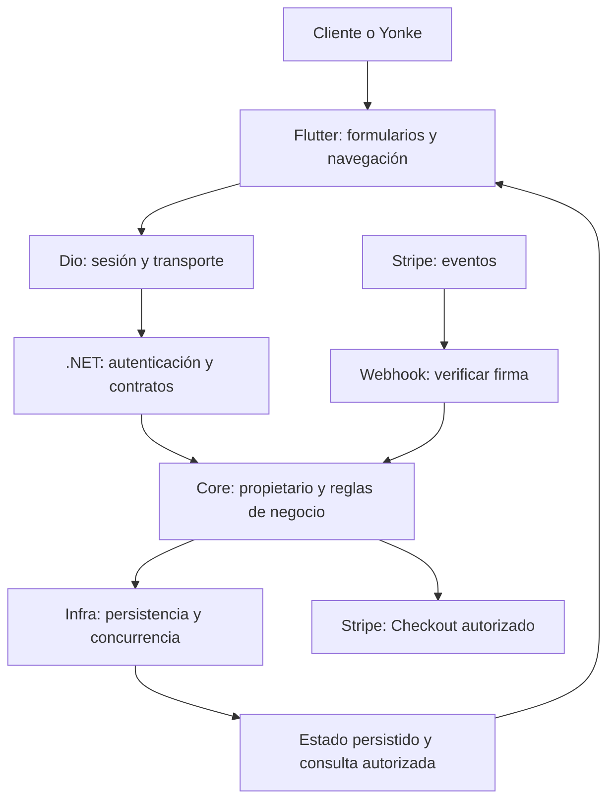
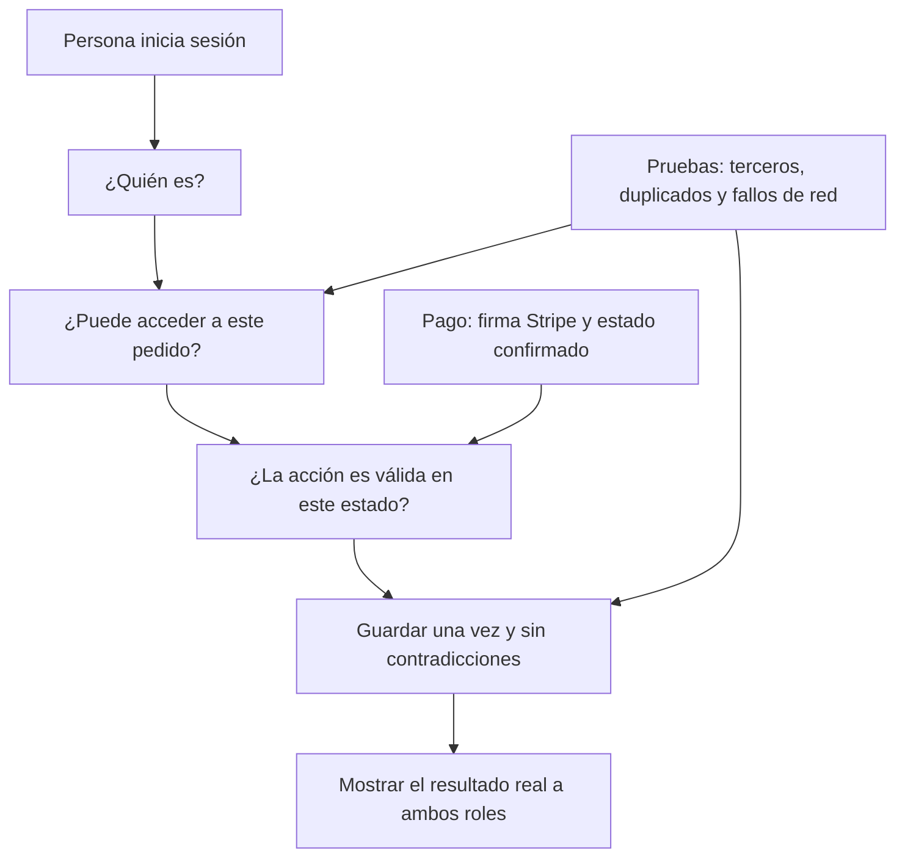

# Mapa de cambios: seguridad primero

Fecha: 4 de octubre de 2026. Complementa el plan de cierre. No es certificado de seguridad ni aprobación de producción.

## 1. Qué cambia y qué permanece

Se conserva la arquitectura de capas .NET y la organización Flutter. Se fortalecen los controles en el lugar adecuado, evitando que esconder un botón sea la única protección.

Los candados que deben existir: identidad válida al entrar; permiso sobre el recurso al consultar/modificar; transición válida al aceptar/cancelar/pagar; actualización consistente al guardar. Stripe no confirma un pago por visitar una pantalla: el backend verifica y persiste su resultado.

## 2. Registro de cambios y pruebas

| Prioridad / área | Por qué cambiar | Qué se mejora y dónde | Prueba exigida | Estado real |
|---|---|---|---|---|
| P0: cancelación de orden | El servicio asigna estado sin comprobar transición previa | Core debe bloquear cancelaciones no permitidas y coordinarse con pago; controlador mantiene contrato | Orden pagada no cambia a cancelada; tercero rechazado; carrera con webhook | Hallazgo en fuentes; corrección backend pendiente |
| P0: permisos por objeto | Un GUID conocido no otorga permiso | Servicios y consultas autorizan propietario/rol/asignación; DTO limita campos internos | Cliente B no lee/modifica solicitud de A; Yonke no asignado no abre chat privado | Revisión completa y pruebas pendientes; no afirmar bypass confirmado en todos los endpoints |
| P0: resultado de pago | Retorno anónimo anuncia éxito sin comprobar estado | Mensaje real, datos mínimos y consulta de resultado protegida; no confiar en retorno | Sesión unpaid no muestra pago confirmado; resultado ajeno rechazado | Hallazgo en fuentes; corrección pendiente |
| P0: webhook y concurrencia | Eventos pueden repetirse o llegar fuera de orden | Conservar firma existente; completar/verificar deduplicación, transacciones y transiciones monotónicas | Firma inválida no cambia datos; duplicado no duplica efectos; fallo antiguo no revierte pago | Firma e índices observados; comportamiento E2E pendiente |
| P0: secretos y transporte | Credenciales no deben salir en código/logs ni enviarse a otro host | Configuración privada, HTTPS y destino confiable; revisión de artefactos | Logs sin secretos; destino externo no recibe bearer; build release seguro | Exclusiones Git/logs parciales existentes; revisión y bloqueo de destino pendientes |
| P1: sesión | Un 401 tardío podía borrar una sesión nueva | Dio comprueba revisión y token antes de limpiar; cachés separadas por sesión | Respuesta de cuenta anterior no borra la nueva ni entrega datos antiguos | Corrección local y regresión aprobadas; atomicidad del almacén aún pendiente |
| P1: OTP/login | Abuso, enumeración y reutilización deben controlarse en servidor | Límites, uso único, caducidad, políticas de renovación/revocación | OTP usado/vencido rechazado; intentos limitados; respuesta no enumera cuentas | Controles por auditar; no vulnerabilidad confirmada sin revisar/probar |
| P1: archivos | Extensión y MIME del cliente no prueban contenido seguro | Validación real de archivo, tamaño/nombre y permisos en backend | Archivo inesperado/grande rechazado; foto privada inaccesible a tercero | Pendiente revisión e implementación según hallazgos |
| P1: creación/recuperación de orden | Perder respuesta no significa que no se creó | Flutter consulta orden existente; servidor debe cerrar duplicación concurrente | Timeout recupera una orden; solicitudes simultáneas no crean dos | Recuperación app probada localmente; concurrencia backend pendiente |
| P1: mensajes y lectura | Un fallo silencioso deja contadores incoherentes | App avisa lectura pendiente y reintenta; servidor debe persistir remitente/destinatario y lectura | Reiniciar conserva lectura; tercero no marca/le envía; reintento no duplica | Aviso/reintento local incorporados; prueba real pendiente |
| P1: perfil y logo | Caché puede ocultar una foto guardada; cambios no deben alterar campos internos | App invalida imagen/resolutor; servidor valida campos permitidos y persistencia | Logo reaparece actualizado tras reinicio/segundo dispositivo; cambio de rol bloqueado | Invalidación app local; persistencia/seguridad backend pendientes |
| P2: adaptación visual | Captura sin overflow no garantiza legibilidad | Distribuciones por tamaño lógico, navegación lateral, acciones alcanzables y texto ampliado | Interactuar en vertical/horizontal/teclado; revisión individual | Navegación y pruebas de captura locales; aprobación visual completa pendiente |

P0 = requisito antes de publicar o habilitar cobros. P1 = requisito antes del cierre funcional. P2 no significa opcional: requiere aceptación visual antes de entregar. La prioridad ordena trabajo, no expresa CVSS ni un nivel de riesgo certificado.

## 3. Ejemplos didácticos para el cliente

### Ejemplo A: cancelar una compra ya pagada

Situación encontrada: el backend comprueba al propietario, pero la actualización de estado no comprueba si la cancelación es válida desde el estado previo.

Mejora propuesta: el servidor verifica propietario y estado en una operación protegida frente a concurrencia. Si ya pagó, no permite una cancelación directa: aplica el procedimiento de devolución aprobado.

Beneficio esperado: el registro de la compra no se contradice con el pago. **Todavía no implementado en backend ni probado en Azure.**

### Ejemplo B: cambio de cuenta mientras llega una respuesta

Antes: una petición antigua devolvía 401 y podía cerrar la cuenta recién iniciada.

Ahora, localmente: se comprueba que la respuesta pertenezca a la sesión actual antes de limpiar sus credenciales. La regresión se probó con respuesta en vuelo.

Beneficio comprobado en la prueba: la sesión nueva permanece. **No certifica atomicidad de todas las operaciones concurrentes ni flujo remoto.**

### Ejemplo C: abrir una pantalla que dice «pago exitoso»

Situación encontrada: el retorno puede mostrar mensaje de éxito aunque el estado devuelto no sea paid.

Mejora propuesta: la app consulta al servidor y representa pendiente/confirmado/fallido según resultado persistido. El webhook valida firma y vínculo del pago antes de actualizar.

Beneficio esperado: no se confirma una compra solo por entrar a una URL. **Firma existente observada; corrección del retorno y validación completa pendientes.**

### Ejemplo D: leer un mensaje sin conexión

Mejora local: el historial disponible permanece visible y aparece lectura pendiente con reintento cuando falla la sincronización.

Beneficio: el usuario sabe que la lectura aún no se confirmó. Para aprobarlo como flujo terminado falta reconectar y verificar el contador persistido en otra sesión real.

## 4. Orden de ejecución para presentar avances

1. Línea base compilable y pruebas aisladas, sin usar bases ni servicios reales.
2. Corregir órdenes/pagos y revisar autorización por objeto/campo.
3. Asegurar sesión, OTP, archivos, red y secretos.
4. Verificar recuperación, mensajes, perfiles y coherencia entre roles.
5. Probar Stripe test y eventos adversos, revisar pantallas y ejecutar regresión final.
6. Publicar cambios revisados en repositorios adecuados; staging primero y producción como paso separado.

Cada entrega debe mostrar: riesgo original, diff acotado, prueba aprobada, alcance de verificación y pendiente restante. No entregar porcentajes de «seguridad» inventados.

## 5. Mapa pequeño para presentar al cliente

Este mapa muestra el objetivo de mejora. La revisión de sesión nueva está implementada y probada localmente; los candados completos del backend siguen en ejecución pendiente. No presentarlo al cliente como arquitectura ya certificada o desplegada.
