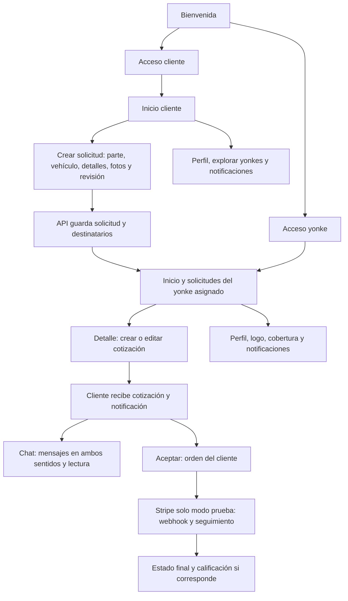

# Plan funcional en celular: cliente ↔ yonke

## Objetivo y alcance

Ejecución parcial documentada: [Resultados reales del Samsung, 2026-10-04](RESULTADOS_CELULAR_20261004.md). Navegación pública comprobada; flujos privados y recepción pendientes de sesiones QA válidas.

Probar en el Samsung SM-A356E la app Refanet instalada, verificando navegación, recepción entre roles y persistencia. Una pantalla bonita o una respuesta HTTP 200 no bastan: comprobar el resultado en el otro rol y después de recargar.

Este documento es un plan, no una declaración de pruebas aprobadas. No modificar otras apps, cuentas personales, fotos privadas, contactos ni ajustes permanentes. No enviar SMS repetidos, pagos reales ni eliminar registros ajenos. Usar archivos sintéticos para las fotos. Los cambios comerciales se limitan a cuentas y registros de prueba identificados; si el entorno resulta de producción, detener las acciones de escritura hasta delimitar esos registros.

## Estado inicial — 2026-10-04

- [x] Artemis instalado y servidor MCP probado.
- [x] Celular conectado y autorizado; resolución física 1080 × 2340.
- [x] App `com.refanet.app` instalada y captura real de bienvenida obtenida.
- [ ] Recorridos funcionales completos: no ejecutados.
- [ ] Credencial de modelo Artemis: diagnóstico actual `blocked / Key Missing`.
- [ ] Cuentas cliente y yonke de prueba con JWT real y entorno identificado.
- [ ] Versión instalada comparada con el código local y versión backend.
- [ ] Grabación de vídeo opcional: falta scrcpy. No bloquea capturas.

No introducir claves en el chat: configurarlas localmente en `C:/Users/PC/Documents/artemis_mobile_testing/.env`. No confundir un acceso visual de prueba con una sesión autorizada en la API.

## Mapa de funciones



## Preparación y datos compartidos

1. Registrar versión/build de app, commit local si corresponde, URL backend, fecha, Android, tamaño lógico, densidad y escala de texto. No volcar tokens ni datos personales.
2. Identificar un cliente y un yonke de prueba; confirmar cobertura del yonke y sus permisos. No cambiar de usuario mientras una operación está enviándose.
3. Crear un identificador de corrida `QA-AAAAMMDD-HHMM` y usarlo en descripciones de prueba. Registrar GUID de solicitud, asignación al yonke, cotización, conversación y orden: son IDs distintos, no intercambiarlos.
4. Partir de una solicitud nueva para el flujo principal; usar otros registros propios para cancelación y validaciones. No exigir igualdad entre todos los contadores: el yonke puede recibir pedidos de otros clientes; comparar el registro QA y el incremento esperado.
5. Guardar capturas y resultados en `build/mobile_qa/<corrida>/`; redactar cualquier dato sensible. No publicar capturas personales en GitHub.
6. Primero explorar cada ruta real con estado/captura y árbol de interfaz; después automatizar usando texto/semántica y esperas explícitas. No pulsar coordenadas inventadas.

## Matriz de pruebas

| ID | Apartado | Acción y resultado que debe verificarse |
|---|---|---|
| A01 | Bienvenida | Ambos botones abren el acceso correcto; volver no deja navegación rota. |
| A02 | Acceso cliente | Validaciones de número/código, OTP autorizado, sesión persistente y cierre de sesión. No generar SMS sin necesidad. |
| A03 | Acceso yonke | Correo/contraseña, errores claros, registro y recuperación con cuentas de prueba; no presentar éxito si API rechaza. |
| A04 | Sesiones | Alternar roles; cada uno ve sus datos, no caché del usuario anterior. Token vencido obliga a autenticarse sin bucles. |
| C01 | Inicio cliente | Saludo, solicitud nueva, solicitudes, cotizaciones, recientes y botones de navegación funcionan; contadores concuerdan con su API. |
| C02 | Catálogos | Categoría, marca y modelo proceden de API; cambiar marca limpia modelo incompatible; carga/error/vacío visibles. |
| C03 | Nueva solicitud | Recorrer pasos y pantallas auxiliares: vehículo, detalles, ubicación, fotos y revisión; validar requisitos sin perder borrador al volver. |
| C04 | Fotos | Sin fotos no aparecen imágenes hardcodeadas; seleccionar imagen sintética, quitarla y revisar el archivo enviado. Permiso rechazado no bloquea toda la app. |
| C05 | Publicación | Un envío crea una sola solicitud; doble toque/reintento no duplica. Persisten datos tras recargar. |
| C06 | Solicitudes/detalle | Lista, búsqueda/filtros disponibles, vehículo, descripción, fotos, estado y destinatarios coinciden con el registro enviado. |
| C07 | Cancelación | Confirmación y cancelación de solicitud QA propia; refrescar ambos roles y verificar estado acordado. No cancelar pedidos reales. |
| C08 | Explorar yonkes | Búsqueda, filtros y perfil abren el yonke correcto; datos vacíos no se inventan. |
| C09 | Cotizaciones | Lista/detalle muestran el precio, garantía, disponibilidad y yonke reales; aceptar cotización propia crea orden consistente. |
| C10 | Orden/seguimiento | Total calculado por servidor, estado correcto y persistente; respuesta perdida no produce segunda orden al reintentar. |
| C11 | Perfil | Edición, direcciones, opciones de pago, soporte y preferencias según implementación; distinguir guardado local de guardado API. |
| C12 | Calificación | Solo cuando estado y permisos lo permiten; guardar una valoración QA y comprobar reputación sin duplicados. |
| Y01 | Inicio yonke | Resumen, recientes y enlaces; conservar solicitud QA aunque cambie de nueva a revisión/cotizada. |
| Y02 | Solicitudes | Tabs/estados, filtros, detalle, fotos y ubicación; solo asignaciones permitidas. |
| Y03 | Cotizar | Precio/garantía/condiciones válidos; cotización asociada a solicitud y yonke correctos. Enviar una sola vez. |
| Y04 | Cotizaciones | Enviadas/aceptadas, detalle y edición permitida; cliente recibe actualización y no desaparece del listado incorrectamente. |
| Y05 | Perfil/logo | Guardar teléfono/dirección/responsable y logo sintético; actualización inmediata y tras salir/entrar, sin imagen antigua de caché. |
| Y06 | Cobertura | Guardar solo cobertura QA acordada; comprobar qué destinatarios recibe la solicitud, sin modificar cobertura real. |
| N01 | Notificaciones | Ambos roles reciben eventos soportados; abrir dirige al ID correcto; estado leído y contadores se mantienen tras refrescar. |
| M01 | Mensajes | Cliente→yonke y yonke→cliente: cuerpo, remitente, orden temporal e historial iguales; no mensajes duplicados. |
| M02 | Lecturas | Leer desde destinatario reduce no leídos; persiste tras recargar; el emisor no marca como leído por sí mismo. |
| M03 | Adjuntos | Probar archivo sintético si la API admite adjuntos; si no, registrar función no disponible, no simular éxito. |
| P01 | Stripe | Solo claves/entorno test: éxito, cancelación, fallo y webhook repetido; URL de retorno por sí sola no confirma pago. Bloqueado sin configuración test. |

## Secuencia de extremo a extremo en un solo celular

1. Cliente publica solicitud QA; guardar ID y captura del detalle.
2. Cerrar sesión o cambiar por el mecanismo real; ingresar como yonke QA. Buscar exactamente la solicitud creada y comprobar fotos/datos.
3. Yonke envía cotización; guardar ID, captura y estado.
4. Cliente entra de nuevo: localizar esa cotización, verificar notificación y precio; no comparar listas independientes de datos ficticios.
5. Cliente envía mensaje QA; yonke lo recibe y lee; cliente comprueba lectura. Repetir en dirección inversa.
6. Cliente acepta cotización; confirmar orden y efecto en estado del yonke. Probar pago únicamente en Stripe test si está habilitado.
7. Cerrar y abrir app: solicitud, cotización, mensajes, lecturas y orden continúan coherentes.

Un solo dispositivo permite pruebas secuenciales entre roles, no demuestra recepción simultánea en segundo plano. Push/tiempo real simultáneo requiere un segundo dispositivo o emulador con otra sesión; marcar pendiente hasta disponer de él.

## Adaptación y casos de error

- Capturar vertical y horizontal cuando Android/app lo permitan, registrar si orientación está bloqueada; restaurar ajustes temporales.
- Teclado abierto: campos, validaciones y botón principal accesibles mediante scroll; nada oculto sin posibilidad de acceder.
- Texto ampliado, contenido largo, listas vacías y listas extensas: sin overflow, recortes ni botones superpuestos.
- Botón Atrás, cambio de rol, volver desde detalle y reabrir app: navegación y borradores predecibles.
- Probar timeout, offline y respuestas 400/401/403/404/409/500 mediante entorno controlado o dobles. No cortar conectividad general del celular ni provocar errores sobre registros ajenos.
- Si falla una recepción: comprobar primero IDs, filtros, cobertura, sesión y estado HTTP. Diferenciar fallo de UI, autorización, lógica backend y persistencia; no atribuir causa sin evidencia.

## Qué hacer cuando una prueba falla

Detener el caso dependiente, tomar captura, anotar pasos y datos QA, revisar logs limitados a la app y respuesta redactada si disponible. Reproducir una vez si no duplica escrituras. Registrar el problema; no insistir indefinidamente ni saltar un fallo como aprobado. Cambios de código se harán en una etapa separada, con nueva ejecución del caso y su regresión.

Plantilla de incidencia:

```text
ID / severidad: crítico, alto, medio o visual
Rol / pantalla / versión / entorno / orientación:
Precondiciones e IDs QA (sin JWT):
Pasos exactos:
Esperado:
Resultado real / texto del error / HTTP si conocido:
Captura y log redactado:
Reproducibilidad y efecto en el otro rol:
Causa: confirmada o hipótesis (evidencia):
Acción propuesta y prueba de regresión:
Estado: pendiente / bloqueado / aprobado / fallido:
```

## Criterios de cierre

- Cada fila ejecutada tiene evidencia o bloqueo explícito; ningún apartado se aprueba solamente por abrir.
- Flujo QA cliente→solicitud→yonke→cotización→chat→orden funciona con datos reales de prueba compartidos y recarga.
- No hay duplicados, pérdida de datos ni mezcla entre usuarios en los casos ejecutados.
- Pruebas visuales reflejan el celular real, no una captura simulada reescalada.
- Pendientes Stripe, SQL, push simultáneo y permisos quedan claramente separados de lo aprobado.
- Entregar resumen breve al usuario con errores, impacto y enlaces a evidencias. No fusionar ni desplegar a Azure automáticamente.
