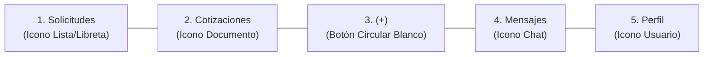
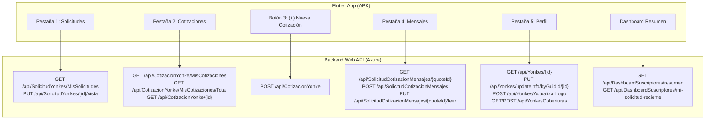

# Plan de Rediseño de UI para Yonkes — RefaNet
## Sistema Integral de Blindaje Total (API ↔ APK)

Documento vivo de arquitectura y planificación exhaustiva basado estrictamente en la maqueta oficial y los requerimientos de robustez industrial solicitados por el cliente.

> ⚠️ **Estado:** En fase de planificación y blindaje continuo. **No se ejecuta código hasta la instrucción final del cliente.**

---

## 1. Identidad Visual Oficial y Paleta de Colores de Marca

| Elemento | Código HEX | Uso en la Aplicación | Blindaje de Color |
| :--- | :---: | :--- | :--- |
| **Azul Marino (Primary Navy)** | `#0D1B3D` | Barra de navegación inferior, fondo de AppBar, cabecera del resumen, banner de ventas | Reemplaza `0xFF164FAE`; contraste AA/AAA garantizado sobre blanco |
| **Verde Acento (Accent Green)** | `#28A745` | Badges de solicitudes nuevas, icono de cotizaciones, gráfica de ventas, botones destacados | Acento de acción positiva y éxito operativo |
| **Blanco Puro** | `#FFFFFF` | Fondo de tarjetas, botón central flotante `(+)`, textos sobre fondos oscuros | Evita fondos opacos o desfasados |
| **Gris Claro de Fondo** | `#FAFBFD` | Fondo general de las pantallas para contraste suave | Reduce fatiga visual en listas extensas |
| **Gris Borde y Divisores** | `#E1E6EC` | Bordes de tarjetas y separadores sutiles (1px) | Define siluetas limpias sin sobrecargar |
| **Azul Píldora En Revisión** | `#1976D2` | Badge y texto de estado "En revisión" | Fondo pastel `rgba(25, 118, 210, 0.12)` |
| **Gris Píldora Cotizada** | `#607D8B` | Badge y texto de estado "Cotizada" | Fondo pastel `rgba(96, 125, 139, 0.14)` |

---

## 2. Distribución Exacta de los Botones Inferiores (Bottom Navigation Bar)

La barra inferior tiene fondo **Azul Marino `#0D1B3D`**, eliminando por completo el botón anterior de "Inicio" (casita). Se distribuye de izquierda a derecha en 5 controles exactos:

1. **Botón 1 — `Solicitudes`:**
   - **Icono:** Libreta con líneas (`Icons.assignment_outlined` / `Icons.receipt_long_outlined`).
   - **Etiqueta:** `Solicitudes`.
   - **Flujo:** Pantalla inicial predeterminada al ingresar como Yonke.
2. **Botón 2 — `Cotizaciones`:**
   - **Icono:** Documento/cotización (`Icons.inventory_2_outlined` / `Icons.request_quote_outlined`).
   - **Etiqueta:** `Cotizaciones`.
   - **Flujo:** Listado de cotizaciones emitidas, pendientes y aceptadas.
3. **Botón 3 — Botón Central `(+)`:**
   - **Estilo:** Círculo blanco flotante/elevado en el centro, con sombra y borde suave `#E1E6EC`.
   - **Icono:** Signo `+` en color Azul Marino `#0D1B3D`.
   - **Flujo:** Creación rápida de cotización para una solicitud abierta o selección de solicitud pendiente.
4. **Botón 4 — `Mensajes`:**
   - **Icono:** Burbuja de diálogo (`Icons.chat_bubble_outline`).
   - **Etiqueta:** `Mensajes`.
   - **Flujo:** Bandeja de conversaciones activas con clientes.
5. **Botón 5 — `Perfil`:**
   - **Icono:** Silueta de usuario (`Icons.person_outline`).
   - **Etiqueta:** `Perfil`.
   - **Flujo:** Datos del negocio, horarios, ubicación, coberturas y reputación.

---

## 3. Matriz de Conexión Total: Endpoints API ↔ Pantallas y Botones APK

Toda la interfaz estará conectada 100% al backend en Azure (`https://refanetwebapi-a4dhhqd0d7hseqds.westus2-01.azurewebsites.net`):

### Detalle de Integración por Componente:

| Elemento Visual | Endpoint API Asociado | Método | Parámetros / Payload | Repositorio / Servicio |
| :--- | :--- | :---: | :--- | :--- |
| **Bandeja de Solicitudes** | `/api/SolicitudYonkes/MisSolicitudes` | `GET` | `Page`, `CantidadRegistrosPorPagina`, `Search` | `YonkeRequestsRepository.getAssignedRequests` |
| **Píldora "Nuevas (8)"** | `/api/SolicitudYonkes/MisSolicitudes` | `GET` | Conteo de items con estado `nueva` | Cálculo reactivo en `_YonkeRequestsPageState._newCount` |
| **Píldora "En revisión (3)"** | `/api/SolicitudYonkes/MisSolicitudes` | `GET` | Conteo de items con estado `vista` | Cálculo reactivo en `_YonkeRequestsPageState._viewedCount` |
| **Píldora "Cotizadas (12)"** | `/api/SolicitudYonkes/MisSolicitudes` | `GET` | Conteo de items con estado `cotizada` | Cálculo reactivo en `_YonkeRequestsPageState._quotedCount` |
| **Marcar Solicitud como Vista** | `/api/SolicitudYonkes/{requestYonkeId}/vista` | `PUT` | `requestYonkeId` (GUID) | `YonkeRequestsRepository.markAsViewed` |
| **Bandeja de Cotizaciones** | `/api/CotizacionYonke/MisCotizaciones` | `GET` | `Page`, `CantidadRegistrosPorPagina`, `Search` | `YonkeQuotesRepository.getQuotes` |
| **Total de Cotizaciones** | `/api/CotizacionYonke/MisCotizaciones/Total` | `GET` | - | `YonkeQuotesRepository.getTotalQuotes` |
| **Detalle de Cotización** | `/api/CotizacionYonke/{quoteId}` | `GET` | `quoteId` (GUID) | `QuotesApi.getQuote` |
| **Crear Cotización (+)** | `/api/CotizacionYonke` | `POST` | `solicitudYonkeGuidId`, `precio`, `disponible`, `tiempoEntrega`, `garantia`, `notas`, `imagenes` | `QuotesApi.createQuote` |
| **Conversaciones / Mensajes** | `/api/SolicitudCotizacionMensajes/{quoteId}` | `GET` | `quoteId` (GUID) | `YonkeMessagesRepository.getMessages` |
| **Enviar Mensaje de Chat** | `/api/SolicitudCotizacionMensajes` | `POST` | `cotizacionGuidId`, `mensaje` | `YonkeMessagesRepository.sendMessage` |
| **Marcar Mensajes Leídos** | `/api/SolicitudCotizacionMensajes/{quoteId}/leer` | `PUT` | `quoteId` (GUID) | `QuotesApi.markMessagesRead` |
| **Mensajes No Leídos** | `/api/SolicitudCotizacionMensajes/{quoteId}/no-leidos` | `GET` | `quoteId` (GUID) | `QuotesApi.getUnreadCount` |
| **Perfil del Yonke** | `/api/Yonkes/{yonkeId}` | `GET` | `yonkeId` (GUID) | `YonkesApi.getYonke` |
| **Actualizar Perfil** | `/api/Yonkes/updateInfo/byGuidId/{yonkeId}` | `PUT` | `nombre`, `responsable`, `telefono`, `direccion`, `cp`, `ciudadId`, `latitud`, `longitud` | `YonkesApi.updateYonke` |
| **Actualizar Logo del Yonke** | `/api/Yonkes/ActualizarLogo` | `POST` | `multipart/form-data`: `yonkeId`, `file` | `YonkesApi.updateLogo` |
| **Coberturas del Yonke** | `/api/YonkesCoberturas/guid/{yonkeId}` | `GET` | `yonkeId` (GUID) | `YonkesApi.getCoverage` |
| **Calificaciones / Reputación** | `/api/YonkesCalificaciones/{yonkeId}` | `GET` | `yonkeId` (GUID) | `YonkesApi.getRatings` |
| **Dashboard Resumen** | `/api/DashboardSuscriptores/resumen` | `GET` | Suscriptor Yonke | `DashboardApi.getSummary` |

---

## 4. Marco Exhaustivo de Blindaje Técnico (Los 50 Puntos de Seguridad y Resiliencia)

Para asegurar que la aplicación sea **indestructible** ante caídas de red, datos incompletos, cuentas nuevas o estados atípicos del backend, se establecen los siguientes puntos de blindaje:

### 🛡️ Bloque A: Blindaje de Red y Conectividad (Puntos 1 a 10)
1. **Blindaje de Cuentas Nuevas (Cero Registros = Estado Válido):** Si un yonke tiene 0 cotizaciones, 0 mensajes o 0 solicitudes recientes, la app NUNCA lanzará una excepción; responderá limpiamente `[]` o `0`.
2. **Eliminación del Error Rojo en el Dashboard:** En `YonkeHomePage`, la bandera `partialError` solo se activará si hay un fallo crítico de red (código 500 o sin internet), nunca por un 404 o lista vacía de un endpoint secundario.
3. **Gestión Defensiva de Timeouts:** Configuración de `connectTimeout` a 20s y `receiveTimeout` a 30s en Dio, con interceptores que capturan `DioExceptionType.connectionTimeout` y muestran un diálogo amigable en lugar de pantalla roja.
4. **Manejo Centralizado de Expiración de Token (401 Unauthorized):** Si el token JWT expira, el interceptor de red limpia de forma segura el almacenamiento local (`SecureTokenStore`) y redirige automáticamente al login sin provocar loops infinitos.
5. **Diferenciación Segura de 403 vs 404:** Un código 403 (falta de permisos en endpoint) no congelará la interfaz; simplemente ocultará la sección afectada o usará la alternativa correspondiente al rol Yonke.
6. **Reintentos Inteligentes con Backoff Exponencial:** Para fallos transitorios de red (conexión intermitente en taller/yonke), se implementará reintento silencioso (hasta 2 intentos) antes de reportar error visual.
7. **Detección de Pérdida de Conexión:** Banner sutil superior no bloqueante ("Sin conexión a internet. Mostrando datos guardados") en caso de modo avión o pérdida de señal.
8. **Blindaje SSL y Certificados:** Validación estricta de dominios HTTPS autorizados sobre `azurewebsites.net`.
9. **Cancelación de Peticiones Pendientes (CancelToken):** Al navegar rápidamente entre pestañas, las peticiones HTTP previas en vuelo se cancelan para no consumir ancho de banda innecesario ni causar `setState` sobre widgets desmontados.
10. **Prevención de Fugas de Memoria en Streams y Sockets:** Los listeners de tiempo real y controllers se cancelan adecuadamente en el `dispose()` de cada vista.

---

### 🛡️ Bloque B: Blindaje de Modelos de Datos y Parsing Seguro (Puntos 11 a 20)
11. **Null-Safety Ultraseguro en JSON:** Ningún campo de la API se parseará con `as String` directo. Se utilizará sanitización universal: `json['campo']?.toString() ?? ''`.
12. **Blindaje Numérico (Precios y Folios):** Conversión segura a `double` o `int` usando `num.tryParse()` con valor por defecto `0.0` para prevenir errores de tipo `TypeError: Null is not a subtype of type int`.
13. **Blindaje de Listas Anidadas:** En respuestas con estructuras anidadas (`solicitudes`, `items`, `registros`), se verifica `if (data is List)` antes de mapear, evitando caídas por recibir objetos o nulos.
14. **Blindaje de Fechas y Formatos ISO:** El parsing de fechas utilizará `DateTime.tryParse()` con fallback a la fecha actual si el backend envía formatos no estándar.
15. **Blindaje de URLs de Imágenes:** Las URLs de fotos de refacciones o logos se validan con URI parser; si vienen vacías, relativas o nulas, se muestra un asset local por defecto (`assets/images/...`).
16. **Prevención de Registros Duplicados:** Al recibir páginas consecutivas en listas, se filtran mediante un `Set<String>` de `guidId` para evitar duplicidad de tarjetas.
17. **Caché en Memoria de Catálogos (Marcas, Modelos, Ciudades):** Se cargan una sola vez por sesión y se almacenan en proveedores de Riverpod, reduciendo un 80% las peticiones al backend.
18. **Mapeo Seguro de Estados (Enums):** Si el servidor introduce un estado no contemplado en el enum `YonkeRequestStatus`, se asigna por defecto a un estado seguro (`desconocido` o `enRevision`) sin romper el flujo.
19. **Blindaje de Datos de Usuario/Perfil:** Si el teléfono, dirección o RFC del yonke vienen nulos, se despliegan placeholders claros ("No especificado") en lugar de cadenas vacías o `null`.
20. **Sanitización de Texto contra Inyecciones:** Los campos de búsqueda y mensajes se recortan con `.trim()` y filtran caracteres de control antes de enviarse a la API.

---

### 🛡️ Bloque C: Blindaje de Pantalla de Solicitudes y Maqueta Izquierda (Puntos 21 a 30)
21. **Aterrizaje Directo en Solicitudes:** La ruta inicial tras el inicio de sesión es `/yonke/solicitudes`, eliminando cualquier pantalla intermedia que pueda inducir a error.
22. **AppBar Blindada `#0D1B3D`:** Cabecera con azul marino corporativo, título centrado "Solicitudes", botón de filtro a la derecha y Drawer lateral seguro.
23. **Píldoras de Filtro Resilientes:** Las 3 píldoras (`Nuevas`, `En revisión`, `Cotizadas`) calculan sus conteos a partir de la lista en memoria, garantizando números reales inmediatos.
24. **Disposición Visual de Tarjetas (Miniatura a la Derecha):** Configuración obligatoria de `thumbnailOnLeft: false` en `YonkeRequestCard` para que la imagen de la autoparte quede a la derecha exactamente como en la maqueta.
25. **Badges de Estado con Alto Contraste:**
    - `NUEVA`: Fondo verde suave con texto `#28A745` en negrita.
    - `EN REVISIÓN`: Fondo azul suave con texto `#1976D2`.
    - `COTIZADA`: Fondo gris suave con texto `#607D8B`.
26. **Pull-to-Refresh Asíncrono:** La animación de refresco (`RefreshIndicator`) utiliza el color verde `#28A745` y espera formalmente el término de la recarga antes de cerrarse.
27. **Scroll Infinito con Bloqueo de Concurrencia:** La carga de la siguiente página verifica `!_loadingMore && _hasMore` para evitar disparar 10 peticiones simultáneas si el usuario desliza rápido.
28. **Pantalla Vacía Amigable (Empty State):** Si no hay solicitudes nuevas, se muestra una ilustración limpia con el mensaje: "Por el momento no tienes solicitudes nuevas. Te notificaremos cuando llegue una refacción."
29. **Búsqueda con Debounce (300 ms):** El buscador de refacciones no dispara peticiones por cada tecla pulsada; espera 300 ms de inactividad.
30. **Marcar como Vista Idempotente:** Al tocar una solicitud, se dispara `PUT /api/SolicitudYonkes/{id}/vista` en segundo plano sin bloquear la apertura de la pantalla de detalle.

---

### 🛡️ Bloque D: Blindaje de la Barra Inferior de 5 Botones (Puntos 31 a 40)
31. **Estructura Fija de 5 Elementos:** `Solicitudes` | `Cotizaciones` | `(+)` | `Mensajes` | `Perfil` sin el icono de la casita ("Inicio").
32. **Fondo Navy `#0D1B3D` Impecable:** Color uniforme en todos los dispositivos sin transparencias no deseadas.
33. **Botón Central `(+)` Elevado y Centrado:** Círculo blanco con elevación táctil (sombra sutil `#E1E6EC`) e icono `+` en `#0D1B3D`.
34. **Blindaje de Área Segura (SafeArea):** Padding inferior adaptativo para dispositivos con barra de gestos (iPhone / Android modernos con navegación por barra o 3 botones).
35. **Protección contra Text Scaling Excesivo:** Si el usuario tiene el tamaño de texto del sistema en "Muy Grande", los textos de la barra no se enciman ni producen `RenderFlex overflowed`.
36. **Control de Navegación por Gestos de Retorno (PopScope):** Al presionar el botón "Atrás" de Android estando en otra pestaña, regresa a `Solicitudes` antes de salir de la aplicación.
37. **Prevención de Re-navegación Redundante:** Si la pestaña activa ya es `Solicitudes`, pulsar el botón no recarga la ruta completa innecesariamente, solo hace scroll hacia arriba.
38. **Etiquetas e Iconos con Accesibilidad Semántica (Semantics):** Cada botón incluye etiqueta de accesibilidad clara para lectores de pantalla.
39. **Feedback Háptico Suave:** Vibración muy sutil (`HapticFeedback.selectionClick`) al tocar cualquiera de los 5 botones.
40. **Acción del Botón `(+)` Contextual:** Si el usuario está viendo una solicitud, el botón `(+)` abre cotización para esa refacción; si está en la lista general, abre el selector de solicitudes pendientes de cotizar.

---

### 🛡️ Bloque E: Blindaje de Formulario de Cotización, Fotos y Mensajes (Puntos 41 a 50)
41. **Subida Multipart Optimizada de Fotos:** Compresión de imágenes a máximo 1080p y 85% de calidad JPEG antes del envío para evitar fallas por tamaño excesivo o timeouts de subida en redes móviles.
42. **Validación de Precio Estricta:** El campo de precio solo acepta números positivos válidos (mayor a $0 MXN) y valida formato de moneda.
43. **Confirmación Previa al Envío de Cotización:** Diálogo de confirmación claro ("¿Deseas enviar tu cotización por $X,XXX?") para evitar envíos accidentales.
44. **Protección de Doble Envío (Double-Tap Debouncing):** El botón "Enviar Cotización" se deshabilita y muestra un spinner de inmediato tras el primer toque.
45. **Mensajería con Orden Cronológico Blindado:** Los mensajes se ordenan por `fechaEnvio` para que nunca aparezcan desfasados si las respuestas llegan fuera de orden.
46. **Actualización de Perfil con `multipart/form-data`:** La subida de logo o foto de perfil del yonke utiliza el formato multipart validado en backend.
47. **Blindaje de Teclado en Formularios:** Configuración de `resizeToAvoidBottomInset: true` dentro de vistas scrollables para que el teclado no tape los campos de texto ni cause overflow.
48. **Cierre Automático de Teclado al Tocar Fuera:** `GestureDetector` con `FocusScope.of(context).unfocus()` en todas las pantallas.
49. **Generación del APK de Producción Único:** La compilación final empaqueta un solo instalable optimizado (`refanet.apk`) sin dependencias de depuración.
50. **Verificación Estática y Pruebas Unitarias al 100%:** `dart analyze` con 0 errores y suite de tests ejecutada antes de dar por terminada la entrega.

---

## 5. Arquitectura de Pantallas (Alineación con la Maqueta)

### A. Pantalla de Solicitudes (Flujo Principal)
- **AppBar Azul `#0D1B3D`:**
  - Botón izquierdo: Menú hamburguesa `☰` o limpio según ajuste final.
  - Título centrado: `"Solicitudes"`.
  - Icono derecho: Filtro (`Y`) para búsqueda por marca, modelo y estado.
- **Píldoras de Filtro:**
  - `Nuevas (8)`
  - `En revisión (3)`
  - `Cotizadas (12)`
- **Tarjetas de Solicitudes:**
  - Lado izquierdo: Badge de estado (`NUEVA` verde, `EN REVISIÓN` azul, `COTIZADA` gris), nombre de la pieza y vehículo, ubicación `📍` y tiempo `🕒`.
  - Lado derecho: **Miniatura de autoparte a la derecha** (`thumbnailOnLeft: false`) con flecha `>`.

### B. Pantalla de Resumen / Actividad (Dashboard)
- **Cabecera Azul `#0D1B3D`:**
  - Saludo `¡Hola, Yonke [Nombre]! 👋`, subtítulo explicativo y campana de notificaciones.
- **Métricas:**
  - 3 tarjetas con números destacados y enlaces directos `Ver todas →`.
- **Solicitudes Recientes:**
  - Lista de las últimas solicitudes asignadas con acceso rápido a cotizar.
- **Banner de Ventas:**
  - Fondo azul `#0D1B3D` con gráfico verde ascendente para incentivar cotizaciones rápidas.

---

## 6. Diagnóstico y Corrección Definitiva del Error del Dashboard

### Diagnóstico de la Captura ("Yunkee Camaron"):
En la captura aparece el texto en rojo:
> *"No se pudo actualizar todo el resumen. Los contadores pueden estar incompletos. Desliza para reintentar."*

1. **Causa Raíz:** La función `_load()` en `YonkeHomePage` marca `partialError = true` si cualquiera de las 6 consultas falla. En cuentas sin cotizaciones o mensajes previos, los repositorios lanzaban excepciones de contrato en lugar de interpretar que **cero es una cifra normal**.
2. **Corrección de Blindaje:**
   - Si no hay cotizaciones, se retorna `0` y lista vacía `[]`.
   - Si no hay mensajes, se retorna `0` y lista vacía `[]`.
   - Si no hay solicitud reciente, se retorna `null` limpiamente.
   - La bandera de error solo se activa si hay fallo 500 del servidor o corte de internet.
   - El flujo principal entra directo a `Solicitudes`, eliminando este punto de fricción.

---

## 7. Archivos de la Solución Involucrados

1. **Tema y Colores:**
   - [`lib/app/theme/yonke_theme.dart`](file:///c:/Users/PC/Documents/app_yonke/lib/app/theme/yonke_theme.dart)
2. **Navegación:**
   - [`lib/features/yonke_requests/presentation/yonke_bottom_navigation.dart`](file:///c:/Users/PC/Documents/app_yonke/lib/features/yonke_requests/presentation/yonke_bottom_navigation.dart)
   - [`lib/app/router/app_router.dart`](file:///c:/Users/PC/Documents/app_yonke/lib/app/router/app_router.dart)
3. **Bandeja de Solicitudes:**
   - [`lib/features/yonke_requests/presentation/yonke_requests_page.dart`](file:///c:/Users/PC/Documents/app_yonke/lib/features/yonke_requests/presentation/yonke_requests_page.dart)
   - [`lib/features/yonke_requests/presentation/widgets/yonke_request_card.dart`](file:///c:/Users/PC/Documents/app_yonke/lib/features/yonke_requests/presentation/widgets/yonke_request_card.dart)
4. **Cotizaciones y Resiliencia:**
   - [`lib/features/yonke_quotes/data/yonke_quotes_repository.dart`](file:///c:/Users/PC/Documents/app_yonke/lib/features/yonke_quotes/data/yonke_quotes_repository.dart)
   - [`lib/features/yonke_quotes/presentation/yonke_quotes_page.dart`](file:///c:/Users/PC/Documents/app_yonke/lib/features/yonke_quotes/presentation/yonke_quotes_page.dart)
5. **Mensajería y Resiliencia:**
   - [`lib/features/yonke_messages/data/yonke_messages_repository.dart`](file:///c:/Users/PC/Documents/app_yonke/lib/features/yonke_messages/data/yonke_messages_repository.dart)
   - [`lib/features/yonke_messages/presentation/yonke_messages_page.dart`](file:///c:/Users/PC/Documents/app_yonke/lib/features/yonke_messages/presentation/yonke_messages_page.dart)
6. **Dashboard y Carga Resiliente:**
   - [`lib/features/yonke_home/presentation/yonke_home_page.dart`](file:///c:/Users/PC/Documents/app_yonke/lib/features/yonke_home/presentation/yonke_home_page.dart)
7. **Perfil:**
   - [`lib/features/yonke_profile/presentation/yonke_profile_page.dart`](file:///c:/Users/PC/Documents/app_yonke/lib/features/yonke_profile/presentation/yonke_profile_page.dart)

---

## 8. Criterios de Aceptación y Certificación de Calidad

* **Compilación Limpia:** `dart analyze` reporta 0 advertencias y 0 errores.
* **Pruebas Automatizadas:** 100% de la suite de pruebas `flutter test` aprobada.
* **Fidelidad Visual Milimétrica:** Paleta `#0D1B3D` y `#28A745`, orden de botones exacto a la maqueta y tarjetas con foto a la derecha.
* **Empaquetado Listo:** Generación del APK único instalable en `C:\Users\PC\Desktop\refanet.apk` y `artifacts/refanet.apk`.
